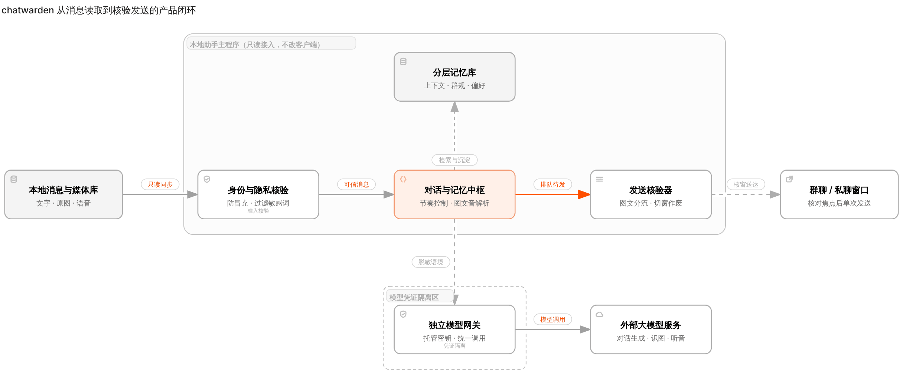
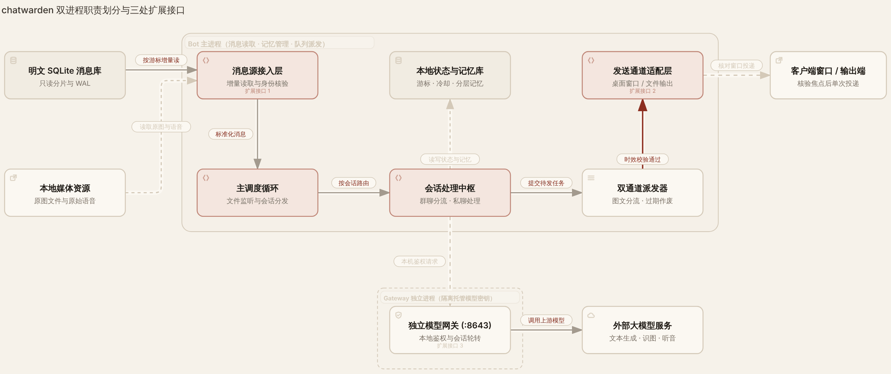
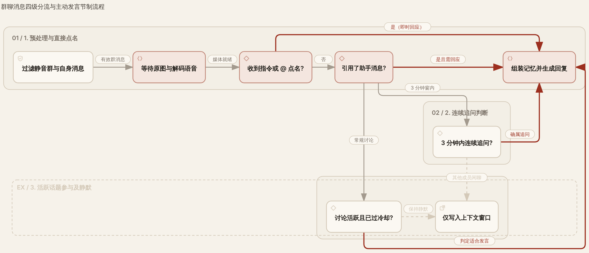
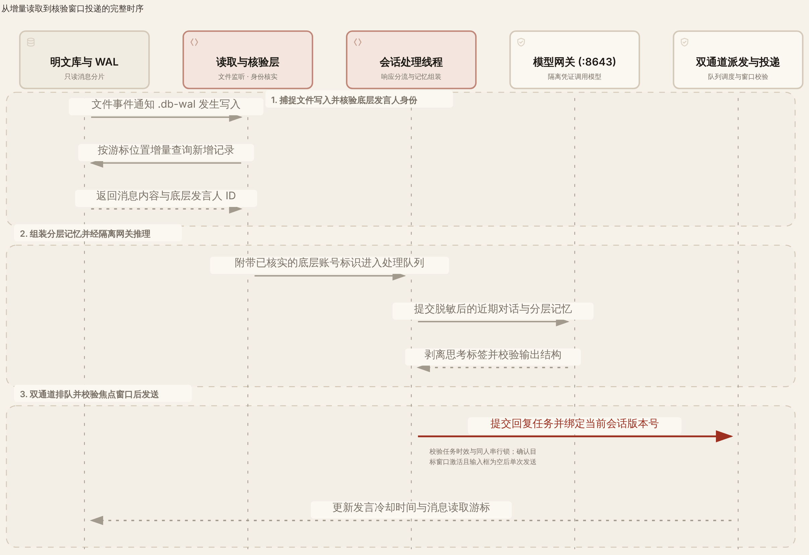
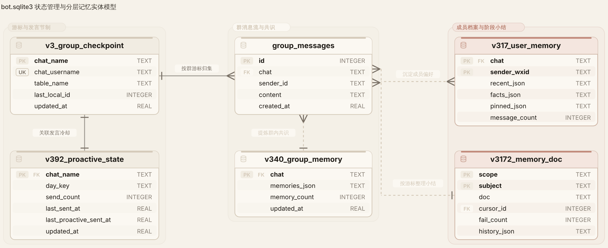

# chatwarden

[中文](README.md) · [Architecture](docs/ARCHITECTURE.md) · [Contributing](CONTRIBUTING.md)

**A group- and private-chat assistant that knows when to speak, remembers, and plays by the rules.** chatwarden reads new messages from a local message store that is **already readable**, listens quietly most of the time, and joins in only when it is called, followed up, or a lively discussion invites it. It looks at full-size images, listens to the original voice audio, remembers per-group agreements and per-member preferences, and hands replies to the sink you configure.

> **Disclaimer**
> 1. This project is not affiliated with, authorized by or endorsed by Tencent or any of its products.
> 2. It contains and provides no code, tools or instructions for decrypting chat databases, extracting keys or reverse-engineering private protocols, and accepts no such contributions.
> 3. It is for personal study and research only.
> 4. You are responsible for complying with the terms of service of any platform you use it with, and with your local law.

<picture>
  <source media="(prefers-color-scheme: dark)" srcset="docs/images/overview-dark.png">
  
</picture>

The diagrams are labelled in Chinese; the sections below explain each one.

## At a glance

- **Read-only, client untouched.** Reads only plain SQLite files that are already on disk and readable, incrementally by cursor. No decryption, key extraction or memory scanning of any kind.
- **Four levels of pacing.** Direct calls, replies to the bot's own message, a 3-minute follow-up window, and proactive turns are triaged in that order. A proactive turn is followed by a 40-minute quiet period and counts against a daily quota.
- **Per-group memory, no sensitive data stored.** Recent messages, group agreements, member preferences, rolling summaries and private-chat summaries live in separate tables; long digit strings, password-like terms and internal ids are filtered before writing.
- **Trusts accounts, not nicknames, and checks again before sending.** Permissions depend only on the underlying sender id. Text and image replies queue separately; a reply that is stale or aimed at the wrong window is dropped instead of landing in the wrong chat.
- **Model credentials isolated in a second process.** The bot never holds the upstream API key; it calls any OpenAI-compatible model through a local HTTP gateway.

## Architecture

Two processes. The **bot** (`bot/bot.py`) reads messages, decides, keeps memory and dispatches replies. The **gateway** (`gateway/server.py`, standard library only, `127.0.0.1:8643` by default) holds the model key and turns the bot's requests into OpenAI-compatible calls. They share only local HTTP and a bearer key.

<picture>
  <source media="(prefers-color-scheme: dark)" srcset="docs/images/architecture-dark.png">
  
</picture>

Three extension points, each chosen by environment variable (details in [docs/ARCHITECTURE.md](docs/ARCHITECTURE.md)):

| Interface | Bundled | Selected by |
| --- | --- | --- |
| Message source | `plain`: a directory of ordinary SQLite files; `tools/replay_jsonl.py` replays a JSONL transcript into one | `CW_DB_BACKEND` |
| Message sink | `console` (print), `jsonl` (file), `agent_wechat` (desktop client, see below) | `CW_SINK` |
| Model gateway | any OpenAI-compatible chat completions service | `CW_LLM_BASE_URL` / `CW_LLM_API_KEY` / `CW_LLM_MODEL` |

How you obtain a readable store is out of scope. For real sending, the `agent_wechat` sink targets the container environment of the open-source [thisnick/agent-wechat](https://github.com/thisnick/agent-wechat) project; it is off by default.

## Group chats: when to speak, when to listen

<picture>
  <source media="(prefers-color-scheme: dark)" srcset="docs/images/group-triage-dark.png">
  
</picture>

1. **Called directly:** a command, an @-mention or the bot's nickname gets an immediate answer.
2. **Quoted:** a member quotes the bot's message and expects a reply.
3. **Follow-up:** for 3 minutes after a reply, a light judge decides whether an un-@ message continues the same thread; other members' chatter is left alone.
4. **Proactive:** once at least 3 ordinary messages arrive within 240 seconds and the cooldown has passed, the bot waits about 8 seconds for the burst to finish, then a judge decides whether to say anything. Group and proactive intervals both default to 2400 seconds, and a proactive turn does not open a follow-up window.

A **rule prefilter** sits in front of the follow-up and proactive judges. Rules can only say "no" (pure laughter, bracketed emoji, short reactions and the like), saving a model call when they match. The default `CW_PREFILTER=shadow` only logs whether rules and model agree; switch to `active` once the agreement rate looks right.

## What a reply passes through

<picture>
  <source media="(prefers-color-scheme: dark)" srcset="docs/images/reply-sequence-dark.png">
  
</picture>

- **Read:** file-change events (falling back to polling) wake the reader, which queries new rows by cursor and never writes to the source store.
- **Identity:** a sender is trusted only when both the underlying sender id and the server message id are valid; nicknames and command-looking text prefixes count for nothing.
- **Inference:** the model sees only redacted recent context and relevant memory; the gateway strips reasoning tags and retries once on malformed structured output.
- **Delivery:** text and vision use separate queues, serialized per member and concurrent across members. Each job is bound to a session version and dropped if config reloads or it goes stale. The desktop sink sends once, only after confirming the target window is active and its input box is empty.
- **Slow work doesn't block:** group voice is transcribed on its own pool (`CW_VOICE_ASYNC=1`), so other members' messages keep flowing; if image recognition takes longer than `CW_VISION_SLOW_ACK_SEC` (default 20 s), the bot first sends a short "still looking" notice.

## Memory and state

<picture>
  <source media="(prefers-color-scheme: dark)" srcset="docs/images/state-tables-dark.png">
  
</picture>

Cursors, cooldowns and every memory layer live in the bot's own `bot.sqlite3`, strictly scoped per group.

| Layer | Holds | Limits and rules |
| --- | --- | --- |
| Recent messages | group chat lines; about the last 20 go into a reply | newest 50,000 rows per group, 300,000 total, nothing older than 30 days (`CW_GROUP_MESSAGES_*`; `PER_CHAT=0` restores the old global 10,000-row cap) |
| Member notes | recent activity, lasting preferences, admin-pinned notes | up to 12 recent, 8 preferences, 8 pinned per member; rejected if it holds 7+ consecutive digits or sensitive terms |
| Group agreements | decisions, nicknames, admin-set group rules | 20 per group; admin-set rules are kept indefinitely |
| Rolling summaries | low-frequency background pass that condenses scattered chat | scoped per group; internal ids and paths stripped before writing |
| Private summaries | rolling summary of one-to-one chats | folded into at most 1,500 characters; cues like 之前 / 上次 / 还记得 ("earlier", "last time", "remember") pull matching older lines back into context (`CW_PRIVATE_RECALL=1`) |

## Media and administration

- **Images:** if the thumbnail is too small, wait for the full image (up to about 35 s) and say so honestly instead of guessing.
- **Animated stickers:** fetched only from official domains; 4 evenly spaced frames are tiled and recognized together.
- **Voice:** ignores the client's own transcript; SILK is decoded to 24 kHz WAV and sent to a multimodal model.
- **Catch-up:** "what did I miss?" or "what happened last night?" is summarized by unread count or time range, with internal ids hidden.
- **Private chats:** off by default for non-admins, controlled by a global switch plus a per-contact allowlist; private and group memory never mix.
- **Admin:** enabled only when `CW_OWNER_WXID` is set in `.env`. The admin can change up to 5 settings at a time in a private chat with `/设置` or plain language; important changes need a second confirmation within 120 seconds. `groups.json` is hot-reloaded.

## Five-minute offline demo

No accounts or API keys needed:

```sh
cp .env.example .env
mkdir -p data store
cp examples/groups.example.json data/groups.json
alias dc='docker compose -f docker-compose.yml -f docker-compose.demo.yml'
dc up --build -d

# create a demo store with a group in it, then let the bot pick it up
dc run --rm bot python3 tools/replay_jsonl.py init /store --self wxid_demo_bot --self-name 小卫
dc run --rm bot python3 tools/replay_jsonl.py append /store examples/demo.jsonl
dc restart bot && sleep 10

# "say" something to the bot
dc run --rm bot python3 tools/replay_jsonl.py say /store \
  --chat 20000000001@chatroom --sender wxid_demo_bob --sender-name Bob "@小卫 你好"

sleep 10 && cat data/outbox.jsonl      # the bot's reply (from the demo fake model)
```

## Real use

1. Set `CW_LLM_BASE_URL`, `CW_LLM_API_KEY` and `CW_LLM_MODEL` in `.env`.
2. Point `CW_STORE_DIR` at your plain store directory and set `CW_BOT_WXID` and `CW_ACCOUNT_ID`.
3. Register the groups to serve in `data/groups.json` (see `examples/groups.example.json`).
4. Choose a sink with `CW_SINK`.
5. Adjust the "Reply behaviour" switches in `.env.example` as needed (prefilter, async voice, slow-vision notice, history retention, private recall).
6. `docker compose up --build -d`.

## Tests

```sh
python3 -m unittest tests.test_gateway   # gateway unit tests
sh tests/run_smokes.sh                   # all smoke tests
sh tests/e2e_demo.sh                     # end-to-end demo (run in the container or CI)
```

Everything runs offline: no chat client, model or network. CI runs all three on every push and PR.

## Known limitations

- The code comes straight from a long-running deployment. `core.py` and `GroupWorker` have been split into modules by topic. Log tags and table names keep historical version numbers (such as `[v3.205-prefilter]`, `v3194_*`) that ops tooling relies on.
- The data directory is fixed at `/var/lib/chatwarden` and secrets at `/etc/chatwarden/secrets`; adjust them with mounts.
- The public gateway has no web search, model-management API or owner-agent backend; those commands report that they are unavailable.
- Image generation needs a separate image service, not included here.
- Images and stickers work only when readable files sit next to the store; otherwise those features switch off.

## Contributing

See [CONTRIBUTING.md](CONTRIBUTING.md). Commits need a DCO sign-off (`git commit -s`). Coding agents: read [AGENTS.md](AGENTS.md) first. Report security issues privately as described in [SECURITY.md](SECURITY.md), not in public issues.

## License

[AGPL-3.0](LICENSE).
