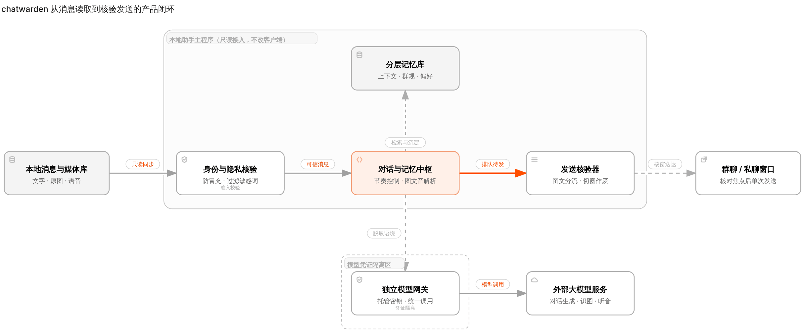
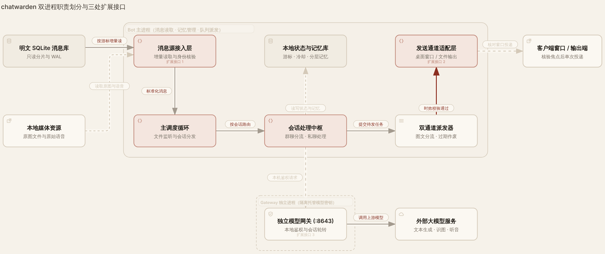
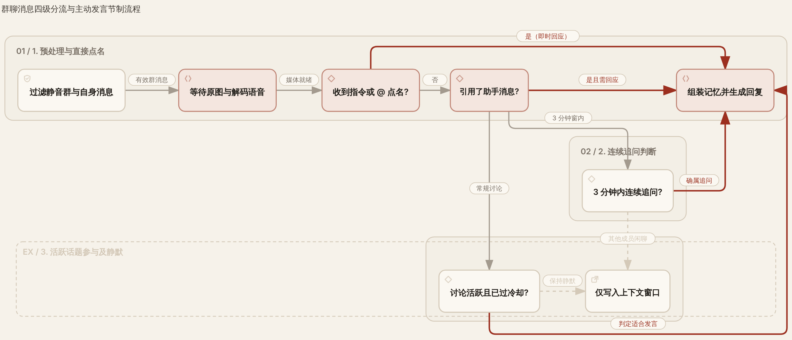
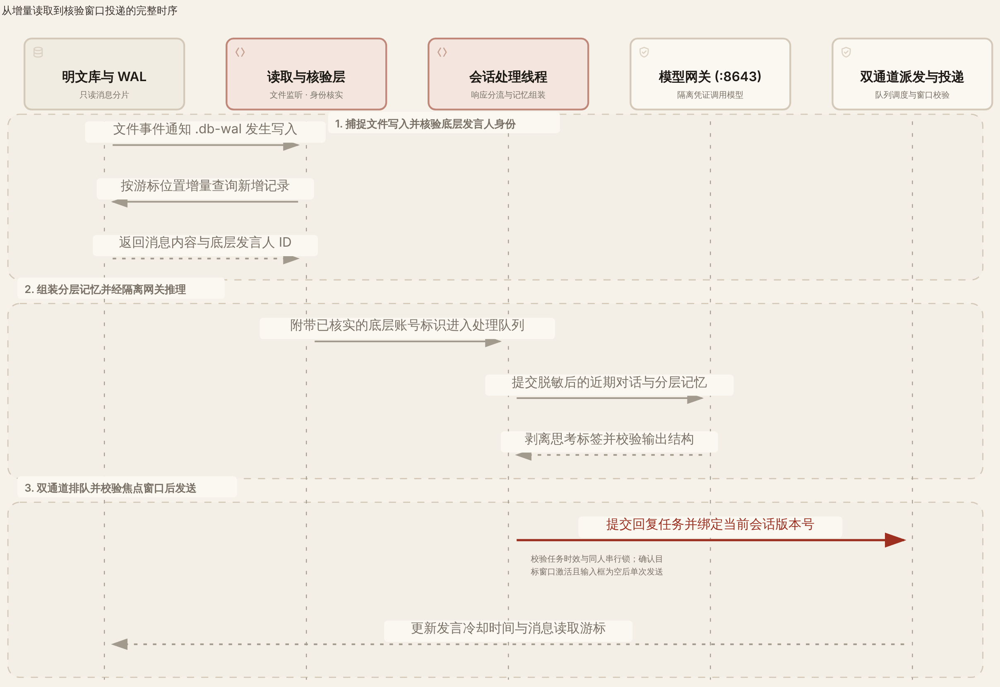
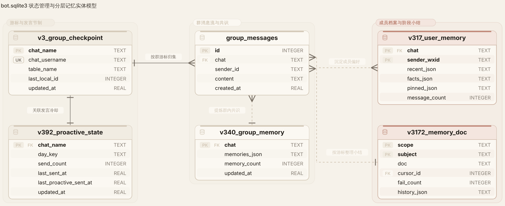

# chatwarden

[English](README.en.md) · [架构文档](docs/ARCHITECTURE.md) · [参与贡献](CONTRIBUTING.md)

**有分寸、有记忆、守规矩的wx群聊与私聊助手。** chatwarden 从一个**已经可读的**本地消息库里读取新消息，平时安静旁听，只在被点名、被追问或讨论正热时自然接话；它能直接看原图、听原声，按群记住共识与成员偏好，再把回复交给你配置的发送端。

> **声明**
> 1. 本项目不包含、不提供任何解密聊天数据库、提取密钥或逆向私有协议的代码、工具或教程，也不接受此类贡献。
> 2. 本项目仅供个人学习与研究使用。
> 3. 使用者需自行确认并承担遵守所用平台服务条款及当地法律的责任。

<picture>
  <source media="(prefers-color-scheme: dark)" srcset="docs/images/overview-dark.png">
  
</picture>

## 一眼看懂

- **只读接入，不改客户端**：只读取本地已落盘、已可读的 SQLite 消息库，按游标增量读取；不含任何解密、密钥提取或内存扫描逻辑。
- **四级节奏控制，避免打扰**：点名必答、引用回复、3 分钟追问窗、主动发言依次分流；主动发言后默认静默 40 分钟，并受每日配额限制。
- **记忆按群隔离，敏感信息不落盘**：近期对话、群内共识、成员偏好、阶段小结与私聊摘要分表存储，写入前过滤长数字串、口令类词条与内部标识。
- **只认底层账号，投递前再核验**：权限只看底层发言人 ID，不看群昵称；图文分通道排队，回复过期或目标窗口不对就作废，不会串群。
- **双进程隔离模型凭证**：Bot 不持有上游模型密钥，只通过本机 HTTP 网关调用任意 OpenAI 兼容模型。

## 架构

两个进程：**Bot**（`bot/bot.py`）负责读消息、做判断、管记忆、派发回复；**Gateway**（`gateway/server.py`，只依赖标准库，默认 `127.0.0.1:8643`）单独持有模型密钥，把 Bot 的请求转成 OpenAI 兼容调用。两者之间只有本机 HTTP 和一个 Bearer 密钥。

<picture>
  <source media="(prefers-color-scheme: dark)" srcset="docs/images/architecture-dark.png">
  
</picture>

三处扩展接口，都通过环境变量选择，细节见 [docs/ARCHITECTURE.md](docs/ARCHITECTURE.md)：

| 接口 | 自带实现 | 选择方式 |
| --- | --- | --- |
| 消息源 | `plain`：读取一个目录下的普通 SQLite 文件；`tools/replay_jsonl.py` 可把 JSONL 对话回放成这样的库 | `CW_DB_BACKEND` |
| 发送端 | `console`（只打印）、`jsonl`（写文件）、`agent_wechat`（桌面客户端，见下） | `CW_SINK` |
| 模型网关 | 任意 OpenAI 兼容的 chat completions 服务 | `CW_LLM_BASE_URL` / `CW_LLM_API_KEY` / `CW_LLM_MODEL` |

如何得到一份可读的消息库不在本项目范围内。真实发送可接入开源项目 [thisnick/agent-wechat](https://github.com/thisnick/agent-wechat)，`agent_wechat` 发送端就是为它的容器环境写的，默认不启用。

## 群聊：什么时候说话，什么时候只听

<picture>
  <source media="(prefers-color-scheme: dark)" srcset="docs/images/group-triage-dark.png">
  
</picture>

1. **点名必答**：收到指令、被 @ 或被叫到昵称时立即回应。
2. **引用回复**：成员引用了助手的消息并需要回应时作答。
3. **短时追问**：刚回复完的 3 分钟内，用轻量判断识别同一话题的追问；别人闲聊则不插话。
4. **主动补充**：240 秒内累计不少于 3 条日常发言、且已过冷却时，先防抖等待约 8 秒收齐语境，再由判断模型决定说还是不说。全群间隔与主动间隔默认都是 2400 秒，主动发言不会再打开追问窗。

追问与主动判断前面有一层**规则预过滤**：规则只会说"不"（比如明显的闲聊、表情、与助手无关的对话），命中时可以省掉一次模型调用。默认是 `CW_PREFILTER=shadow`，只记录规则与模型是否一致、不改变行为；确认一致率后再改成 `active`。

## 一条回复要经过哪些关口

<picture>
  <source media="(prefers-color-scheme: dark)" srcset="docs/images/reply-sequence-dark.png">
  
</picture>

- **读取**：文件变更事件（异常时退回轮询）唤醒读取端，按游标增量查询，从不改写原始消息库。
- **身份**：只有底层发言人 ID 与服务端消息 ID 都有效时才记为可信身份，群昵称和正文里模仿的指令前缀都不作数。
- **推理**：发给模型的只有脱敏后的近期对话与相关记忆；网关剥离思考标签，结构化输出格式不对时自动重试一次。
- **投递**：文字与识图分两条队列，同一成员按序处理、不同成员并发；任务绑定会话版本号，配置重载或已过期就作废。桌面发送端会确认目标窗口处于激活状态且输入框为空后才单次发送。
- **不被慢任务卡住**：群语音转写在独立线程池里进行（`CW_VOICE_ASYNC=1`），不会挡住其他成员的消息；识图超过 `CW_VISION_SLOW_ACK_SEC`（默认 20 秒）还没结果时，先发一句简短的"还在看"。

## 记忆与状态

<picture>
  <source media="(prefers-color-scheme: dark)" srcset="docs/images/state-tables-dark.png">
  
</picture>

读取游标、发言冷却与各层记忆都在 Bot 自己的 `bot.sqlite3` 里，按群严格隔离。

| 层级 | 内容 | 容量与规则 |
| --- | --- | --- |
| 近期消息 | 群聊原文，单次对话带入最近约 20 条 | 每群保留最新 50000 行，总量上限 300000 行，超过 30 天的删除（`CW_GROUP_MESSAGES_*`；`PER_CHAT=0` 退回旧的全局 10000 行） |
| 成员近况与偏好 | 近期动态、长期偏好、管理员置顶 | 每人最多 12 条近况、8 条偏好、8 条置顶；含 7 位以上连续数字或敏感词时拒写 |
| 群内共识 | 群里达成的决定、常用称谓、管理员设定的群规 | 每群上限 20 条；管理员录入的群内设定长期保留 |
| 阶段小结 | 后台低频巡检，把零散对话整理成简明印象 | 按群作用域隔离，写入前剔除内部 ID 与路径 |
| 私聊摘要 | 一对一对话的滚动摘要 | 原文超过阈值时压缩成不超过 1500 字的摘要；提到"之前 / 上次 / 还记得"时，会把相关的旧原文重新带回上下文（`CW_PRIVATE_RECALL=1`） |

## 多模态与管理

- **图片**：缩略图太小时先等原图（最多约 35 秒），没等到就如实说明，不盲猜。
- **动图表情**：只从官方域名取资源，均匀抽 4 帧拼成一张再识别。
- **语音**：不依赖客户端的语音转文字，SILK 解码为 24 kHz WAV 后交给多模态模型直接听。
- **历史回顾**："我错过了什么""昨晚聊了啥"之类的问题，按未读条数或时间范围总结，并隐去内部账号标识。
- **私聊**：非管理员私聊默认关闭，由全局开关加单人白名单控制；私聊与群聊记忆完全隔离。
- **管理员**：只有在 `.env` 里显式填写 `CW_OWNER_WXID` 后才启用。管理员可在私聊里用 `/设置` 或自然语言批量调整（单次最多 5 项），关键变更需要在 120 秒内二次确认。群配置 `groups.json` 热加载。

## 五分钟离线演示

不需要任何账号或 API key：

```sh
cp .env.example .env
mkdir -p data store
cp examples/groups.example.json data/groups.json
alias dc='docker compose -f docker-compose.yml -f docker-compose.demo.yml'
dc up --build -d

# create a demo store with a group in it, then let the bot pick it up
dc run --rm bot python3 tools/replay_jsonl.py init /store --self wxid_demo_bot --self-name 小卫
dc run --rm bot python3 tools/replay_jsonl.py append /store examples/demo.jsonl
dc restart bot && sleep 10

# "say" something to the bot
dc run --rm bot python3 tools/replay_jsonl.py say /store \
  --chat 20000000001@chatroom --sender wxid_demo_bob --sender-name Bob "@小卫 你好"

sleep 10 && cat data/outbox.jsonl      # 机器人的回复（演示用的假模型）
```

## 正式使用

1. 在 `.env` 里填好 `CW_LLM_BASE_URL`、`CW_LLM_API_KEY`、`CW_LLM_MODEL`。
2. 把 `CW_STORE_DIR` 指向你的明文消息库目录，填好 `CW_BOT_WXID` 和 `CW_ACCOUNT_ID`。
3. 在 `data/groups.json` 里登记要服务的群（示例见 `examples/groups.example.json`）。
4. 选择发送端 `CW_SINK`。
5. 按需调整 `.env.example` 里"Reply behaviour"一节的开关（预过滤、异步语音、慢识图提示、历史保留、私聊回忆）。
6. `docker compose up --build -d`。

## 测试

```sh
python3 -m unittest tests.test_gateway   # 网关单元测试
sh tests/run_smokes.sh                   # 全部 smoke 测试
sh tests/e2e_demo.sh                     # 端到端演示（在容器或 CI 中运行）
```

全部离线运行，不需要聊天客户端、模型或网络。CI 在每次推送和 PR 上运行这三项。

## 已知限制

- 代码直接来自一个长期运行的部署，`core.py` 和 `GroupWorker` 已按主题拆分成多个模块；日志标签和表名里保留了历史版本号（如 `[v3.205-prefilter]`、`v3194_*`），运维工具依赖它们。
- 数据目录固定为 `/var/lib/chatwarden`，密钥目录固定为 `/etc/chatwarden/secrets`，请用挂载来调整。
- 公开版 Gateway 不含联网搜索、模型管理接口和主人代理后端，相关指令会提示不可用。
- 图片生成需要一个独立的图片服务，本仓库不包含。
- 图片与表情只在消息库旁有可直接读取的文件时可用，读不到时相应功能自动关闭。

## 参与贡献

见 [CONTRIBUTING.md](CONTRIBUTING.md)。提交需带 DCO 签名（`git commit -s`）。编码代理请先读 [AGENTS.md](AGENTS.md)。安全问题请按 [SECURITY.md](SECURITY.md) 私下报告，不要开公开 issue。

## 许可证

[AGPL-3.0](LICENSE)。
